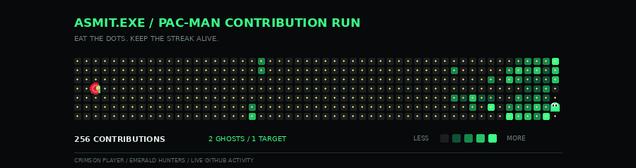

<!-- ========== ASMIT.EXE HERO ========== -->

 

  

<b>ENGINEERING IDEAS INTO REALITY.</b>

Exploring software development, AI/ML and problem solving.

 

<!-- ========== 01 / TECH ARSENAL ========== -->

<h2 align="center">01 / TECH ARSENAL</h2>

 

<!-- ========== 02 / CONSISTENCY PROTOCOL ========== -->

<h2 align="center">02 / CONSISTENCY PROTOCOL</h2>

 

<!-- ========== 03 / PAC-MAN CONTRIBUTION RUN ========== -->

<h2 align="center">03 / PAC-MAN CONTRIBUTION RUN</h2>

 

<b>EAT THE DOTS. KEEP THE STREAK ALIVE.</b>

 

ASMIT.EXE // CONTINUOUS DEVELOPMENT PROTOCOL

<!-- ========== 04 / SYSTEM TELEMETRY ========== -->

<h2 align="center">04 / SYSTEM TELEMETRY</h2>

 

METRICS // CODE // CONSISTENCY

